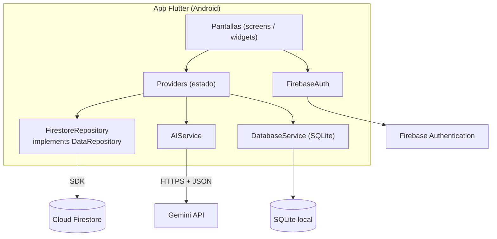
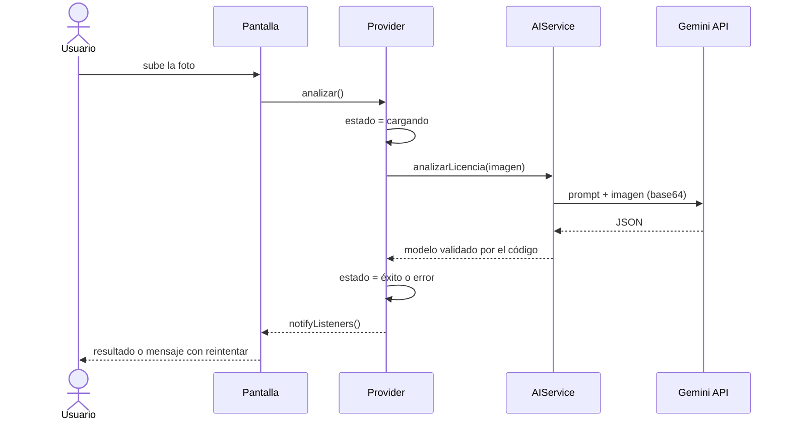

# RentAuto 🚗

App móvil en Flutter para **alquilar vehículos entre particulares** en Pasto, con inteligencia artificial para verificar documentos, buscar y publicar.

Proyecto final de **Desarrollo Móvil** · Universidad de Nariño
**Autor:** Andrés Felipe Noguera · Ingeniería de Sistemas

## Problema que resuelve

En Pasto hay mucha movilidad y una demanda particular de vehículos para viajes cortos a municipios cercanos (Ipiales, Laguna de la Cocha, Túquerres) o para un fin de semana. Las agencias tradicionales de renta suelen ser costosas y burocráticas. RentAuto conecta directamente a dueños de vehículos con personas que necesitan alquilarlos.

## Funcionalidades

- [x] Registro e inicio de sesión (Firebase Authentication)
- [x] Modo cliente y modo dueño con la misma cuenta
- [x] Catálogo con búsqueda, filtros por tipo y precio, y actualización al deslizar
- [x] Publicar vehículos con foto, y gestionar los propios
- [x] Reservas por fechas, sin cruces, con estados: solicitada → aceptada → en curso → finalizada
- [x] Calificaciones y perfil con estadísticas
- [x] Contacto por WhatsApp una vez aceptada la reserva
- [x] 5 funciones de IA (ver abajo)

## Funciones de inteligencia artificial

La IA es **parte del núcleo**: sin ella no se verifican las licencias ni los documentos del vehículo. Se usa la API de Gemini (Google).

| Función | Entrada | Qué hace la IA | Qué valida el código |
|---|---|---|---|
| Validar licencia | Foto del reverso | Extrae cada categoría con su fecha | Que la categoría sirva para el tipo de vehículo y esté vigente |
| Buscar con IA | Una frase | Convierte la frase en filtros | Tipo permitido, precio dentro del rango, texto acotado |
| Leer SOAT y tecnomecánica | Foto del documento | Extrae tipo, placa y vigencia | Documento correcto, vigente, y placas coincidentes |
| Autocompletar vehículo | Foto del vehículo | Sugiere marca, modelo y tipo | El usuario revisa y corrige |
| Precio sugerido | Datos del vehículo | Estima un rango por día | Se ajusta al rango de la app; se presenta como estimación |

**Principio de diseño: la IA lee, el código decide.** Los modelos de lenguaje se equivocan con fechas y reglas, así que ninguna decisión (aprobar una licencia, bloquear un documento vencido) depende de lo que "opine" el modelo.

Cada función maneja cuatro estados (inicial, cargando, éxito, error), con mensajes específicos (sin internet, tiempo agotado, IA saturada) y opción de reintentar. `AIService` hace reintentos con espera creciente y cambia a un modelo de respaldo si el principal no responde.

## Arquitectura



Flujo de una función de IA (ejemplo: validar la licencia):



El diagrama completo está en [`docs/RentAuto_arquitectura.png`](docs/RentAuto_arquitectura.png).

### Decisiones de diseño

- **Capas separadas:** las pantallas no hablan con la base de datos ni con la IA; todo pasa por providers, que usan repositorios y servicios.
- **Interfaz `DataRepository`:** la app empezó con SQLite y se migró a Firestore cambiando una sola línea en `main.dart`.
- **Sin doble reserva:** cada día reservado de un vehículo es un documento (`vehiculoId_aaaa-mm-dd`), creado dentro de una **transacción**. Si dos usuarios compiten por el mismo día, solo uno lo consigue. (El SDK de Firestore no permite consultas dentro de transacciones, por eso se usa este patrón.)
- **Datos locales sensibles:** la licencia validada se guarda en SQLite en el celular, solo categorías y fechas, nunca la foto.

## Seguridad y privacidad

- Las reglas de Firestore están en [`firestore.rules`](firestore.rules): solo los dos participantes leen una reserva, el dueño solo puede cambiar su estado, el cliente solo puede calificar una vez (1 a 5), y nadie borra reservas.
- Solo el dueño puede modificar o eliminar su vehículo.
- La clave de Gemini está en `.env`, fuera del repositorio.
- No se guardan fotos de documentos, solo las fechas de vigencia.

## Tecnologías

| Tecnología | Uso |
|---|---|
| Flutter / Dart | Interfaz y lógica de la app |
| provider | Manejo de estado |
| Firebase Authentication | Cuentas de usuario |
| Cloud Firestore | Vehículos, reservas y ocupación de fechas |
| sqflite | Licencia validada, en el dispositivo |
| Gemini API (`http`) | Funciones de IA |
| image_picker | Cámara y galería |
| url_launcher | Abrir WhatsApp |
| flutter_dotenv | Variables de entorno |
| intl | Formato de fechas y precios |

## Estructura del proyecto

```
lib/
 ├── models/         # Vehiculo, Reserva, ResultadoLicencia, DocumentoVehiculo...
 ├── repositories/   # DataRepository (interfaz) y FirestoreRepository
 ├── services/       # AIService (Gemini) y DatabaseService (SQLite)
 ├── providers/      # Estado de la app y de cada función de IA
 ├── screens/        # Pantallas
 ├── widgets/        # Componentes reutilizables
 └── utils/          # Fechas, formato de precios, contacto
docs/                # Diagrama de arquitectura e imágenes de prueba
firestore.rules      # Reglas de seguridad de Firestore
```

## Cómo ejecutar el proyecto

1. Instalar Flutter y tener un emulador Android o un celular con la depuración USB activa.
2. Clonar e instalar dependencias:
   ```bash
   git clone https://github.com/TU_USUARIO/rentauto.git
   cd rentauto
   flutter pub get
   ```
3. Crear el archivo `.env` en la raíz, a partir de `.env.example`:
   ```
   GEMINI_API_KEY=tu_clave_aqui
   ```
   La clave se obtiene gratis en [Google AI Studio](https://aistudio.google.com).
4. Ejecutar:
   ```bash
   flutter run
   ```

**Firebase:** el proyecto incluye `lib/firebase_options.dart` y se conecta a su proyecto de Firebase. Para usar uno propio, crear el proyecto, habilitar Authentication (correo y contraseña) y Firestore, publicar `firestore.rules`, y correr `flutterfire configure`.

**Probar la app:** registrar dos cuentas (una para el modo dueño y otra para el modo cliente), idealmente en dos dispositivos. Para validar documentos se pueden usar las imágenes ficticias de `docs/pruebas/`.

## Limitaciones conocidas y trabajo futuro

- La IA **lee** los documentos pero no los autentica: verificarlos contra el RUNT requeriría una integración oficial.
- Los pagos no están implementados.
- Las fotos de los vehículos se guardan comprimidas dentro del documento de Firestore (prototipo); en producción irían a Cloud Storage.
- El número de WhatsApp del dueño vive en el documento del vehículo, legible por usuarios con sesión; en producción iría en un documento con acceso restringido.
- La actualización de datos es manual (deslizar para actualizar), no en tiempo real.
- Las reservas se limitan a 14 días.
- La licencia se asocia a la cuenta y se guarda solo en el dispositivo.